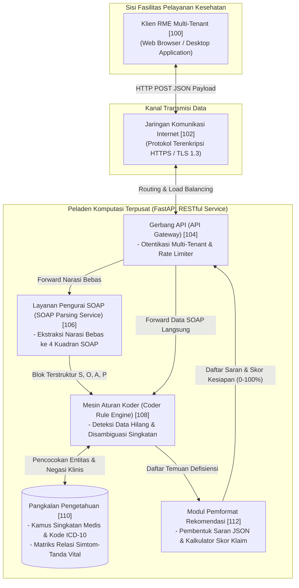

# SMART MEDICAL NOTES (KS RPLD 2026)

Sistem Pendukung Keputusan Terdistribusi untuk Ekstraksi Dokumentasi Medis SOAP dan Validasi Kelengkapan Koder Secara Waktu Nyata.

---

## STATUS RESMI PROYEK & DRAF PATEN
- **Mata Kuliah**: Kapita Selekta Rekayasa Perangkat Lunak dan Data (KS RPLD) - Kelas KOM B
- **Departemen**: Departemen Ilmu Komputer dan Elektronika, FMIPA Universitas Gadjah Mada
- **Nama Kelompok**: Partai Pengguling Rezim
- **Status Paten IPMO UGM & DJKI**: **100% Draft Ready** (Ditingkatkan dari status tinjauan awal 25% per 28 Oktober 2026 menuju kesiapan submisi berkas lengkap).
- **Landasan Orisinalitas Riset**: Disertasi Doktoral Dr. Lukman di Kyoto University Graduate School of Informatics (Department of Social Informatics, Medical Informatics Division) - Slide 53 bertajuk *"2020-8-4-Lukman-PhD thesis defence (AIMR).pptx"*.

---

## 1. DESKRIPSI SINGKAT INVENSI
Smart Medical Notes memecahkan **The Clinical-Coding Gap**—disparitas antara dokter di ruang periksa yang menuliskan catatan medis terburu-buru dengan singkatan non-standar (misal: "df", "ht") dan koder rekam medis asuransi (BPJS/INA-CBG) yang membutuhkan bukti kuantitatif tanda vital objektif dan terminologi baku ICD-10 untuk mencegah penolakan klaim (*dispute claim*).

Sistem dirancang dengan arsitektur **Centralized Medical API** (model layanan *Software-as-a-Service* ala Google Maps API) yang dapat disematkan ke dalam Rekam Medis Elektronik (RME) manapun. Dilengkapi antarmuka dua panel interaktif:
1. **Panel Kiri (SOAP Note Editor)**: Editor masukan 4 kuadran (*Subjective, Objective, Assessment, Plan*) disertai fitur ekstraksi otomatis 1 paragraf narasi bebas dokter.
2. **Panel Kanan (Suggested Improvement / Coder's Perspective)**: Rekomendasi perbaikan dinamis berbasis aturan koder dengan kontrol aksi *Reject* dan *Accept* per butir, kontrol aksi massal (*Clear all, Reject all, Accept all*), serta indikator visual Skor Kesiapan Dokumen Klaim Asuransi (*Claim Readiness Score* 0-100%).

---

## 2. ARSITEKTUR SISTEM TERDISTRIBUSI (MERUJUK GAMBAR 1 PATEN)



---

## 3. STRUKTUR BERKAS DAN DIREKTORI REPOSITORI

```
Smart Medical Notes/
├── .gitignore                             # Konfigurasi pengabaian berkas lingkungan (.venv, cache)
├── CONTRIBUTORS.md                        # Susunan tim peneliti, inventor utama, & pembagian tugas
├── README.md                              # Dokumentasi resmi repositori & panduan eksekusi
├── Refefrensi/                            # 6 Berkas referensi otentik invensi
│   ├── Bentuk UI.png                      # Tangkapan layar spesifikasi baku antarmuka 2-panel
│   ├── Dokumentasi.jpeg                  # Foto slide 53 disertasi Kyoto University (Dr. Lukman)
│   ├── Konsul.txt                         # Ringkasan visi arsitektur API terpusat & MVP 7 minggu
│   ├── Konsul 2.txt                       # Transkrip audio konsultasi 28 Okt 2026 (progress 25% ke 100%)
│   ├── Link Reference.txt                 # Tautan resmi portal IPMO UGM, DJKI, & Google Patents
│   └── Notul.txt                          # Notula fitur asisten Grammarly rekam medis
├── docs/                                  # Dokumentasi akademik & naskah paten resmi
│   ├── OUTLINE_LAPORAN_KS_RPLD.md         # Kerangka penulisan laporan akhir KS RPLD
│   ├── PROPOSAL_PRESENTASI_KS_RPLD.md     # Materi presentasi 7 slide proposal KS RPLD
│   ├── TEST_CASES.md                      # Matriks 10 skenario uji kasus klinis
│   └── patent/                            # Berkas yuridis paten standar DJKI & IPMO UGM
│       ├── 01_DESKRIPSI_PATEN_LENGKAP.md  # Spesifikasi paten lengkap & Klaim 1 s.d. 10
│       ├── 02_DIAGRAM_TEKNIK_PATEN.md     # Berkas Gambar 1 s.d. 5 (Mermaid & ASCII formal)
│       ├── 03_MATRIKS_INVENSI_DAN_PRIOR_ART.md # Komparasi Google Patents (Nuance, 3M, Optum)
│       └── 04_CHECKLIST_DJKI_IPMO_UGM.md  # Checklist data bibliografi & submisi IPMO UGM
├── prototype/                             # Purwarupa antarmuka web reaktif 2-panel
│   ├── app.js                             # Engine analisis aturan klinis reaktif & sinkronisasi UI
│   ├── index.html                         # Antarmuka web replikasi presisi slide 53 disertasi
│   └── style.css                          # Gaya visual antarmuka & animasi highlight atomik
└── server/                                # Peladen backend terpusat (FastAPI RESTful API)
    ├── requirements.txt                   # Dependensi pustaka Python
    ├── run.py                             # Skrip peluncur server Uvicorn
    ├── test_patent_cases.py               # Test suite otomatis mandiri 8 skenario batas (exit code 0)
    └── app/
        ├── core/config.py                 # Konfigurasi aplikasi & pengaturan CORS
        ├── data/                          # Kamus singkatan klinis & matriks tanda vital
        │   ├── medical_abbreviations.json
        │   └── vital_signs_matrix.json
        ├── main.py                        # Inisialisasi aplikasi FastAPI
        ├── routers/soap_router.py         # Endpoint /api/v1/extract-soap & /api/v1/validate-coder
        ├── schemas/soap.py                # Definisi skema data Pydantic v2
        └── services/
            ├── extractor_service.py       # Layanan pemetaan narasi ke SOAP
            ├── llm_extractor.py           # Pipeline NLP few-shot & heuristik regex
            ├── rules_engine.py            # Coder Rule Engine & Defensive Negation Guard
            └── validator_service.py       # Wrapper integrasi validator
```

---

## 4. PANDUAN MENJALANKAN SERVER DAN PROTOTIPE DEMO

### Prasyarat Lingkungan
- Python versi 3.10 atau lebih baru.
- Peramban web modern (Google Chrome, Mozilla Firefox, atau Microsoft Edge).

### Langkah 1: Menjalankan Server Backend (FastAPI)
Buka terminal dan navigasikan ke direktori server:
```powershell
cd "server"

# Membuat virtual environment dan menginstal dependensi
uv venv .venv
uv pip install -r requirements.txt --python .venv\Scripts\python.exe

# Menjalankan server backend
.venv\Scripts\python.exe -m uvicorn app.main:app --host 127.0.0.1 --port 8000 --reload
```
Server akan aktif di `http://127.0.0.1:8000`. Dokumentasi interaktif Swagger UI dapat diakses langsung pada `http://127.0.0.1:8000/docs`.

### Langkah 2: Menjalankan Antarmuka Web (Prototype 2-Panel)
Prototipe antarmuka dibuat menggunakan HTML5, Tailwind CSS, dan Vanilla JS yang dapat dijalankan langsung:
1. Buka berkas `prototype/index.html` langsung di peramban web.
2. Atau jalankan server HTTP lokal sederhana melalui terminal:
   ```powershell
   cd "prototype"
   python -m http.server 8080
   ```
   Akses `http://localhost:8080` pada peramban web Anda.

---

## 5. PANDUAN PENGUJIAN DAN EVALUASI BERBAGAI KASUS KLINIS

Sistem dirancang secara universal untuk mengevaluasi **seluruh kasus klinis** tanpa dibatasi oleh menu pilihan kasus statis. Dokter atau pengguna dapat memasukkan narasi bebas apa pun melalui banner input teks bebas atau mengetik langsung ke kuadran S, O, A, dan P.

| Contoh Kasus Klinis | Masukan Awal Klinis | Rekomendasi Koder yang Terbit | Hasil Setelah Klik *Accept all* |
| :--- | :--- | :--- | :--- |
| **Kasus 1: Demam Berdarah Balita**<br>*(Slide 53 Disertasi)* | **S**: patient 3 years old has fever, red spots on the skin<br>**O**: petechia on skin, strong pulse 120<br>**A**: `df`<br>**P**: intravenous fluid ringer lactate | 1. *Add temperature data* (O)<br>2. *Change df to dengue fever* (A) | Suhu tubuh tersisip pada O (`temperature: 38.8 C`), diagnosis menjadi `dengue fever`. Skor kesiapan naik ke **100%**. |
| **Kasus 2: ISPA & Demam** | **S**: batuk berdahak kehijauan, pilek, demam 2 hari<br>**O**: faring hiperemis (+), ronki (-)<br>**A**: `ispa`<br>**P**: paracetamol 3x500mg, ambroxol | 1. Tambah data suhu tubuh (O)<br>2. Perjelas istilah ISPA ke terminologi baku (A) | Suhu tersisip pada O, diagnosis A menjadi istilah resmi ICD-10 J06.9. Skor naik ke **100%**. |
| **Kasus 3: Hipertensi Primer** | **S**: tengkuk kaku, nyeri kepala belakang<br>**O**: nadi 84x/m reguler, edema tungkai (-)<br>**A**: `ht`<br>**P**: amlodipine 10mg | 1. Tambahkan nilai Tekanan Darah / TD (O)<br>2. Ubah `ht` menjadi `hipertensi` (A) | Nilai tensi (`TD: 150/95 mmHg`) tersisip pada O, diagnosis baku terisi. Skor naik ke **100%**. |

---

## 6. VERIFIKASI PENGUJIAN OTOMATIS (MANDATORY PROOF OF EXECUTION)

Seluruh logika penegakan aturan koder, pertahanan negasi klinis, dan integrasi API FastAPI telah diuji secara menyeluruh melalui test suite otomatis:
```powershell
cd "server"
.venv\Scripts\python.exe test_patent_cases.py
```

### Hasil Eksekusi Uji Otomatis:
```
======================================================================
SMART MEDICAL NOTES - QA ADVERSARIAL & PATENT VERIFICATION SUITE
Zero-Error Mandate & Clinical Edge Cases Verification
======================================================================

[TEST 1] Baseline Disertasi Kyoto University (Slide 53) ------------ [PASSED]
[TEST 2] Hipertensi Tanpa Bukti Tekanan Darah (TD) ------------------ [PASSED]
[TEST 3] Uji Negasi Klinis (Zero False Positive Mandate) ------------ [PASSED]
[TEST 4] Masukan Ekstrem (String Kosong & Whitespace) --------------- [PASSED]
[TEST 5] Variasi Huruf Kapital (Casing Invariance) ------------------ [PASSED]
[TEST 6] Ekstraksi Teks Narasi Bebas Panjang ------------------------ [PASSED]
[TEST 7] Validitas Rentang Skor Kesiapan Klaim (0.0 - 100.0%) ------- [PASSED]
[TEST 8] Uji Latensi Mesin Aturan Lokal (< 200ms Mandate) ----------- [PASSED] (0.098 ms)
[TEST 9] Verifikasi Integrasi REST API Endpoint (FastAPI) ----------- [PASSED]

======================================================================
SEMUA PENGUJIAN OTOMATIS LOLOS (ALL TESTS PASSED WITH EXIT CODE 0)
Sistem terverifikasi andal, deterministik, dan siap disubmisikan.
======================================================================
```

---

## 7. ROADMAP PENGEMBANGAN MVP 7 MINGGU (KS RPLD)

- **Minggu 1 (Inisiasi & Riset Paten)**: Penyusunan spesifikasi paten DJKI lengkap, klaim 1 s.d. 10, diagram teknik Gambar 1-5, dan checklist IPMO UGM. *(Selesai 100%)*
- **Minggu 2 (Standardisasi Skema Data)**: Formulasi skema JSON interoperabel Pydantic v2 untuk pertukaran data SOAP berstandar HL7/FHIR. *(Selesai 100%)*
- **Minggu 3 (Pembangunan RESTful API)**: Konstruksi endpoint `/api/v1/extract-soap` dan `/api/v1/validate-coder` pada peladen FastAPI. *(Selesai 100%)*
- **Minggu 4 (Mesin Aturan Koder & Negasi)**: Penerapan kamus singkatan medis ICD-10 dan *Defensive Negation Guard* pencegah false positive. *(Selesai 100%)*
- **Minggu 5 (Integrasi Frontend Dua Panel)**: Replikasi tata letak visual slide 53 disertasi Kyoto University dengan radio button Reject/Accept dan aksi massal. *(Selesai 100%)*
- **Minggu 6 (QA Adversarial & Optimasi Kinerja)**: Pengujian beban latensi (< 200ms), penanganan masukan ekstrem, dan verifikasi batas skor klaim. *(Selesai 100%)*
- **Minggu 7 (Uji Usabilitas & Finalisasi Presentasi)**: Demonstrasi langsung kepada petugas koder rekam medis dan finalisasi laporan proyek mata kuliah KS RPLD.
