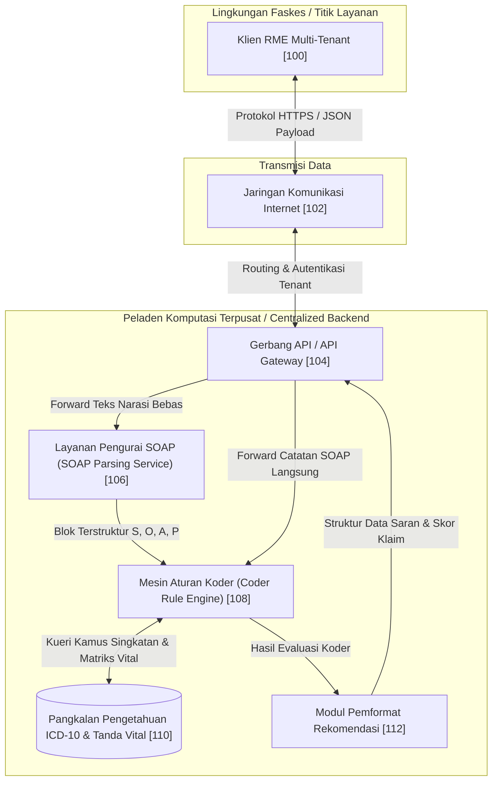
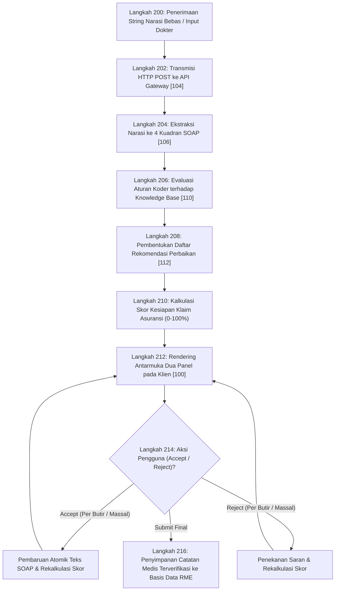
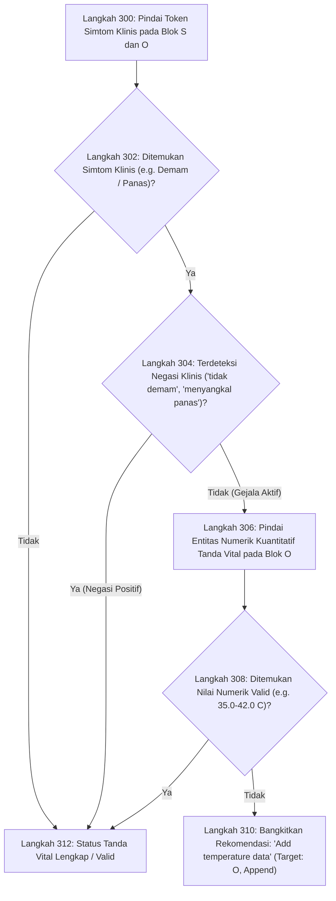
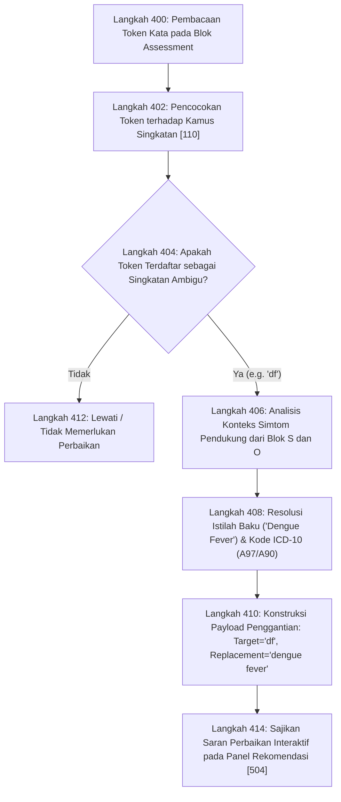

# BERKAS GAMBAR DAN DIAGRAM TEKNIK PATEN RESMI
DIREKTORAT JENDERAL KEKAYAAN INTELEKTUAL (DJKI) KEMENKUMHAM RI &
INTEGRATED PATENT MANAGEMENT OFFICE (IPMO) UNIVERSITAS GADJAH MADA

---

## DAFTAR GAMBAR TEKNIK PATEN
- GAMBAR 1: Diagram Blok Arsitektur Sistem Terdistribusi Dokumentasi Medis dan Validasi Koder
- GAMBAR 2: Diagram Alir Metode Pengolahan Data End-to-End
- GAMBAR 3: Diagram Alir Logika Deteksi Variabel Klinis Esensial yang Hilang
- GAMBAR 4: Diagram Alir Disambiguasi Singkatan Medis Kontekstual
- GAMBAR 5: Diagram Skematik Antarmuka Pengguna Dua Panel Interaktif

---

## GAMBAR 1: DIAGRAM BLOK ARSITEKTUR SISTEM TERDISTRIBUSI DOKUMENTASI MEDIS DAN VALIDASI KODER

### 1. Representasi Diagram Alur Sistem (Mermaid)


### 2. Representasi Gambar Teknik Monokrom Resmi (ASCII Formal)
```
+-------------------------------------------------------------------------+
| GAMBAR 1: DIAGRAM BLOK ARSITEKTUR SISTEM TERDISTRIBUSI                   |
+-------------------------------------------------------------------------+

  [ KLIEN RME MULTI-TENANT ] [100]
  (Browser / Desktop App / Web Plugin)
               ^
               | (Protokol HTTPS / REST Payload)
               v
  ==============================================================
  [ JARINGAN KOMUNIKASI INTERNET ] [102]
  ==============================================================
               ^
               | (Koneksi Terenkripsi TLS 1.3)
               v
  +-------------------------------------------------------------+
  | PELADEN TERPUSAT (CENTRALIZED MEDICAL API SERVICE)          |
  |                                                             |
  |  +-------------------------------------------------------+  |
  |  | GERBANG API (API GATEWAY) [104]                       |  |
  |  | - Otentikasi Multi-Tenant / API Key Management        |  |
  |  | - Rate Limiter & Request Router                       |  |
  |  +-------------------------------------------------------+  |
  |             |                                   ^           |
  |             v                                   |           |
  |  +-------------------------+                    |           |
  |  | LAYANAN PENGURAI SOAP   |                    |           |
  |  | (PARSING SERVICE) [106] |                    |           |
  |  | - NLP Few-Shot Prompt   |                    |           |
  |  | - Regex Fallback Engine |                    |           |
  |  +-------------------------+                    |           |
  |             | (Blok S, O, A, P)                 |           |
  |             v                                   |           |
  |  +-----------------------------------+          |           |
  |  | MESIN ATURAN KODER                |          |           |
  |  | (CODER RULE ENGINE) [108]         |          |           |
  |  | - Detektor Variabel Hilang        |<======>+===================+
  |  | - Disambiguasi Singkatan ICD-10   |        | PANGKALAN         |
  |  | - Evaluasi Kerapihan Terapi Plan  |        | PENGETAHUAN [110] |
  |  +-----------------------------------+        | - Kamus Singkatan |
  |             |                                 | - Kode ICD-10     |
  |             v                                 | - Matriks Vital   |
  |  +-----------------------------------+        +===================+
  |  | MODUL PEMFORMAT REKOMENDASI [112] |          |
  |  | - Penyusun Daftar Saran Perbaikan |          |
  |  | - Kalkulator Skor Kesiapan Klaim  |----------+
  |  +-----------------------------------+
  +-------------------------------------------------------------+
```

---

## GAMBAR 2: DIAGRAM ALIR METODE PENGOLAHAN DATA END-TO-END

### 1. Representasi Diagram Alir (Mermaid)


### 2. Representasi Gambar Teknik Monokrom Resmi (ASCII Formal)
```
+-------------------------------------------------------------------------+
| GAMBAR 2: DIAGRAM ALIR METODE PENGOLAHAN DATA END-TO-END                |
+-------------------------------------------------------------------------+

                     [ MULAI ]
                         |
                         v
  +-------------------------------------------------------------+
  | Langkah 200: Dokter menginput teks narasi bebas atau catatan |
  |              SOAP melalui antarmuka Klien RME [100]         |
  +-------------------------------------------------------------+
                         |
                         v
  +-------------------------------------------------------------+
  | Langkah 202: Transmisi muatan data melalui Jaringan [102]   |
  |              menuju Gerbang API [104] (HTTPS POST)          |
  +-------------------------------------------------------------+
                         |
                         v
  +-------------------------------------------------------------+
  | Langkah 204: Ekstraksi narasi bebas menjadi 4 blok data     |
  |              SOAP (S, O, A, P) oleh Layanan Pengurai [106]  |
  +-------------------------------------------------------------+
                         |
                         v
  +-------------------------------------------------------------+
  | Langkah 206: Evaluasi kepatuhan dokumentasi oleh Mesin      |
  |              Aturan Koder [108] menggunakan Pangkalan       |
  |              Pengetahuan ICD-10 & Matriks Vital [110]       |
  +-------------------------------------------------------------+
                         |
                         v
  +-------------------------------------------------------------+
  | Langkah 208: Pembentukan daftar saran perbaikan spesifik     |
  |              (Suggested Improvements) oleh Pemformat [112]  |
  +-------------------------------------------------------------+
                         |
                         v
  +-------------------------------------------------------------+
  | Langkah 210: Kalkulasi nilai numerik Skor Kesiapan Dokumen   |
  |              Klaim Asuransi (Claim Readiness Score: 0-100%) |
  +-------------------------------------------------------------+
                         |
                         v
  +-------------------------------------------------------------+
  | Langkah 212: Rendering respons data pada antarmuka dua panel |
  |              Klien RME [100] (Editor Kiri, Saran Kanan)     |
  +-------------------------------------------------------------+
                         |
                         v
  +-------------------------------------------------------------+
  | Langkah 214: Pemantauan interaksi pengguna terhadap saran:   |
  |              - Tombol Accept -> Update atomik kolom teks     |
  |              - Tombol Reject -> Abaikan saran, update skor   |
  |              - Tombol Clear all / Reject all / Accept all   |
  +-------------------------------------------------------------+
                         |
                         v
  +-------------------------------------------------------------+
  | Langkah 216: Dokter menekan tombol Submit Final, catatan    |
  |              SOAP berstandar koder disimpan ke database RME |
  +-------------------------------------------------------------+
                         |
                         v
                    [ SELESAI ]
```

---

## GAMBAR 3: DIAGRAM ALIR LOGIKA DETEKSI VARIABEL KLINIS ESENSIAL YANG HILANG

### 1. Representasi Diagram Alir (Mermaid)


### 2. Representasi Gambar Teknik Monokrom Resmi (ASCII Formal)
```
+-------------------------------------------------------------------------+
| GAMBAR 3: LOGIKA DETEKSI VARIABEL KLINIS ESENSIAL YANG HILANG           |
+-------------------------------------------------------------------------+

                     [ MULAI ]
                         |
                         v
  +-------------------------------------------------------------+
  | Langkah 300: Pemindaian leksikon simtom klinis pada teks    |
  |              blok Subjective dan Objective                  |
  +-------------------------------------------------------------+
                         |
                         v
  +-------------------------------------------------------------+
  | Langkah 302: Apakah ditemukan indikasi simtom target        |
  |              (misal: leksikon 'demam', 'panas', 'fever')?   |
  +-------------------------------------------------------------+
                   /             \
             (TIDAK)             (YA)
                 /                 \
                |                   v
                |   +-------------------------------------------+
                |   | Langkah 304: Evaluasi Penjaga Batas       |
                |   |              Negasi Klinis (Defensive     |
                |   |              Negation Guard). Apakah ada  |
                |   |              penanda 'tidak'/'menyangkal'?|
                |   +-------------------------------------------+
                |          /                             \
                |       (YA)                           (TIDAK)
                |        /                                 \
                |       |                                   v
                |       |   +-------------------------------------------+
                |       |   | Langkah 306: Pemindaian data kuantitatif  |
                |       |   |              tanda vital terkait pada     |
                |       |   |              blok Objective (angka Celcius|
                |       |   +-------------------------------------------+
                |       |                           |
                |       |                           v
                |       |   +-------------------------------------------+
                |       |   | Langkah 308: Apakah nilai numerik         |
                |       |   |              kuantitatif ditemukan?       |
                |       |   +-------------------------------------------+
                |       |          /                             \
                |       |       (YA)                           (TIDAK)
                |       |        /                                 \
                |       |       /                                   v
                |       |      /            +-----------------------------------+
                |       |     /             | Langkah 310: Bangkitkan saran     |
                |       |    /              |              penambahan data:     |
                |       |   /               |              "Add temperature     |
                |       |  /                |              data" (Append ke O)  |
                |       v v                 +-----------------------------------+
  +-----------------------------------+                       |
  | Langkah 312: Status tanda vital   |                       |
  |              lengkap / valid      |                       |
  +-----------------------------------+                       |
                   \                                         /
                    \                                       /
                     +------------------+------------------+
                                        |
                                        v
                                   [ SELESAI ]
```

---

## GAMBAR 4: DIAGRAM ALIR DISAMBIGUASI SINGKATAN MEDIS KONTEKSTUAL

### 1. Representasi Diagram Alir (Mermaid)


### 2. Representasi Gambar Teknik Monokrom Resmi (ASCII Formal)
```
+-------------------------------------------------------------------------+
| GAMBAR 4: DIAGRAM ALIR DISAMBIGUASI SINGKATAN MEDIS KONTEKSTUAL         |
+-------------------------------------------------------------------------+

                     [ MULAI ]
                         |
                         v
  +-------------------------------------------------------------+
  | Langkah 400: Pembacaan token kata pada blok Assessment (A)  |
  +-------------------------------------------------------------+
                         |
                         v
  +-------------------------------------------------------------+
  | Langkah 402: Pencocokan token leksikal terhadap entri pada   |
  |              Kamus Singkatan Medis Pangkalan Pengetahuan    |
  |              [110] dengan batasan kata (case-insensitive)   |
  +-------------------------------------------------------------+
                         |
                         v
  +-------------------------------------------------------------+
  | Langkah 404: Apakah token terdaftar sebagai singkatan       |
  |              ambigu (misal: 'df', 'ht', 'ispa', 'dm')?      |
  +-------------------------------------------------------------+
                   /             \
             (TIDAK)             (YA)
                 /                 \
                |                   v
                |   +-------------------------------------------+
                |   | Langkah 406: Ekstraksi fitur konteks      |
                |   |              simtom pendukung dari teks   |
                |   |              blok S dan O (misal: demam,  |
                |   |              bintik merah, ruam, petekia) |
                |   +-------------------------------------------+
                |                           |
                |                           v
                |   +-------------------------------------------+
                |   | Langkah 408: Resolusi istilah baku resmi  |
                |   |              'dengue fever' dan pemetaan  |
                |   |              kode diagnosis ICD-10 A97/A90|
                |   +-------------------------------------------+
                |                           |
                |                           v
                |   +-------------------------------------------+
                |   | Langkah 410: Konstruksi payload saran:    |
                |   |              - Tipe Aksi: replace         |
                |   |              - Target Kata: 'df'          |
                |   |              - Pengganti: 'dengue fever'  |
                |   +-------------------------------------------+
                |                           |
                |                           v
                |   +-------------------------------------------+
                |   | Langkah 414: Sajikan saran perbaikan pada |
                |   |              Panel Rekomendasi Kanan [504]|
                |   +-------------------------------------------+
                v                           |
  +-----------------------------------+     |
  | Langkah 412: Lewati token kata /  |     |
  |              tidak ada saran      |     |
  +-----------------------------------+     |
                   \                       /
                    \                     /
                     +---------+---------+
                               |
                               v
                          [ SELESAI ]
```

---

## GAMBAR 5: DIAGRAM SKEMATIK ANTARMUKA PENGGUNA DUA PANEL INTERAKTIF

### 1. Representasi Diagram Skematik Antarmuka (ASCII Formal)
```
+----------------------------------------------------------------------------------------------------+
| GAMBAR 5: REPRESENTASI SKEMATIK ANTARMUKA DUA PANEL INTERAKTIF                                     |
+----------------------------------------------------------------------------------------------------+
| SMART MEDICAL NOTES - SISTEM PENDUKUNG KEPUTUSAN DOKUMENTASI MEDIS [KLIEN RME 100]                 |
+-------------------------------------------------------------------+--------------------------------+
| PANEL KIRI: SOAP NOTE EDITOR [502]                                | PANEL KANAN: SUGGESTED         |
|                                                                   | IMPROVEMENT [504]              |
| Petunjuk:                                                         |                                |
| 1. Periksa catatan SOAP yang berpotensi ambigu/kurang lengkap.    | Kriteria Koder Asuransi:       |
| 2. Gunakan rekomendasi perbaikan dari panel kanan.                | [2 Saran Aktif]                |
|                                                                   |                                |
| [ S ] Subjective (Keluhan & Riwayat Pasien)                       | Aksi Massal [510]:             |
| +---------------------------------------------------------------+ | [Clear all] [Reject all]       |
| | patient 3 years old has fever, red spots on the skin          | |             [Accept all]       |
| +---------------------------------------------------------------+ | ------------------------------ |
|                                                                   | DAFTAR REKOMENDASI:            |
| [ O ] Objective (Pemeriksaan Fisik & Tanda Vital)                 |                                |
| +---------------------------------------------------------------+ | 1. Add temperature data        |
| | petechia on skin, strong pulse 120                            | |    Kategori: Kelengkapan Vital |
| +---------------------------------------------------------------+ |    Target: Blok O              |
|                                                                   |    Kontrol Aksi [506]:         |
| [ A ] Assessment (Diagnosis Klinis)                               |    ( ) Reject   (*) Accept     |
| +---------------------------------------------------------------+ |                                |
| | df                                                            | | 2. Change df to dengue fever   |
| +---------------------------------------------------------------+ |    Kategori: Singkatan Ambigu  |
|                                                                   |    Target: Blok A (ICD-10 A97) |
| [ P ] Plan (Tatalaksana, Terapi, Obat)                            |    Kontrol Aksi [506]:         |
| +---------------------------------------------------------------+ |    ( ) Reject   (*) Accept     |
| | intravenous fluid ringer lactate                              | | ------------------------------ |
| +---------------------------------------------------------------+ | INDIKATOR KESIAPAN KLAIM [512]:|
|                                                                   | Kesiapan: [ 50% ]              |
| [Tombol Periksa SOAP]                 [SUBMIT FINAL KE RME] [508] | [==========          ] 50%     |
+-------------------------------------------------------------------+--------------------------------+
```

---

## TABEL KONSISTENSI NOMOR RUJUKAN ELEMEN GAMBAR (REFERENCE NUMERAL INDEX)
Untuk menjamin prinsip Zero Dangling References, seluruh nomor rujukan pada Gambar 1 hingga Gambar 5 terdefinisi secara tunggal dan konsisten:

| Nomor Rujukan | Nama Elemen Teknis | Definisi & Peran Komputasi | Kemunculan pada Gambar |
| :---: | :--- | :--- | :--- |
| **100** | Klien RME Multi-Tenant | Perangkat komputasi pengguna (dokter) yang menjalankan antarmuka RME web/desktop. | Gambar 1, 2, 5 |
| **102** | Jaringan Komunikasi Internet | Kanal transmisi data terenkripsi (TLS 1.3/HTTPS) penghubung faskes dengan backend. | Gambar 1, 2 |
| **104** | Gerbang API (API Gateway) | Pintu masuk terpusat pengelola otentikasi multi-tenant, rate limiting, dan routing RESTful. | Gambar 1, 2 |
| **106** | Layanan Pengurai SOAP | Modul pemrosesan bahasa alami pengubah string narasi bebas ke kuadran S, O, A, P. | Gambar 1, 2 |
| **108** | Mesin Aturan Koder | Modul penegak aturan kepatuhan koder, deteksi data hilang, dan resolusi singkatan. | Gambar 1, 2 |
| **110** | Pangkalan Pengetahuan ICD-10 | Basis data terstruktur kamus singkatan medis, terminologi ICD-10, dan matriks vital. | Gambar 1, 2, 4 |
| **112** | Modul Pemformat Rekomendasi | Generator struktur JSON daftar saran dan kalkulator skor kesiapan klaim asuransi. | Gambar 1, 2 |
| **200** | Tahap Input Narasi Bebas | Tahap penerimaan string teks narasi klinis bebas dari dokter. | Gambar 2 |
| **202** | Tahap Transmisi API Gateway | Tahap pengiriman muatan data ke peladen terpusat melalui HTTPS POST. | Gambar 2 |
| **204** | Tahap Ekstraksi Kuadran SOAP | Tahap segmentasi narasi klinis menjadi 4 blok data S, O, A, P terpisah. | Gambar 2 |
| **206** | Tahap Evaluasi Aturan Koder | Tahap validasi silang data SOAP terhadap pangkalan pengetahuan ICD-10. | Gambar 2 |
| **208** | Tahap Pembentukan Saran | Tahap konstruksi butir-butir perbaikan klinis spesifik. | Gambar 2 |
| **210** | Tahap Kalkulasi Skor Klaim | Tahap penghitungan persentase kepatuhan klaim asuransi (0% s.d. 100%). | Gambar 2 |
| **212** | Tahap Rendering Antarmuka | Tahap penampilan editor SOAP dan daftar saran berdampingan pada klien. | Gambar 2 |
| **214** | Tahap Interaksi Aksi Saran | Tahap pemantauan sinyal Accept atau Reject dari pengguna. | Gambar 2 |
| **216** | Tahap Finalisasi Basis Data | Tahap penyimpanan catatan medis terstruktur yang disetujui ke database RME. | Gambar 2 |
| **300** | Pemindaian Simtom Klinis | Langkah membaca entitas keluhan/gejala pada blok S dan O. | Gambar 3 |
| **302** | Uji Keberadaan Simtom | Langkah percabangan ada/tidaknya gejala klinis target. | Gambar 3 |
| **304** | Penjaga Batas Negasi Klinis | Langkah verifikasi ketiadaan kata negasi ('tidak demam', 'menyangkal panas'). | Gambar 3 |
| **306** | Pemindaian Tanda Vital O | Langkah memindai representasi numerik fisiologis pada blok Objective. | Gambar 3 |
| **308** | Uji Nilai Numerik Terukur | Langkah evaluasi ketercukupan data angka kuantitatif tanda vital. | Gambar 3 |
| **310** | Pembentukan Saran Vital | Langkah pembentukan instruksi penambahan nilai tanda vital yang hilang. | Gambar 3 |
| **312** | Status Tanda Vital Valid | Langkah penetapan bahwa pemeriksaan tanda vital telah lengkap/sesuai. | Gambar 3 |
| **400** | Pembacaan Token Assessment | Langkah segmentasi kata pada blok diagnosis kerja dokter. | Gambar 4 |
| **402** | Pencocokan Kamus Singkatan | Langkah penelusuran leksikal ke pangkalan pengetahuan singkatan medis. | Gambar 4 |
| **404** | Uji Keberadaan Singkatan | Langkah percabangan ada/tidaknya singkatan klinis ambigu. | Gambar 4 |
| **406** | Analisis Konteks Simtom | Langkah evaluasi gejala pendukung pada blok S dan O untuk konfirmasi diagnosis. | Gambar 4 |
| **408** | Resolusi Baku & Kode ICD-10 | Langkah penetapan nama resmi diagnosis dan penetapan kode ICD-10 terkait. | Gambar 4 |
| **410** | Konstruksi Payload Pengganti | Langkah penyusunan instruksi penggantian kata secara terstruktur. | Gambar 4 |
| **412** | Langkah Bypass Token Normal | Langkah pengabaian kata-kata yang bukan merupakan singkatan ambigu. | Gambar 4 |
| **414** | Penyajian Saran Singkatan | Langkah perenderan saran perubahan singkatan pada panel antarmuka. | Gambar 4 |
| **502** | Panel SOAP Note Editor | Area kerja panel kiri yang memuat 4 textarea masukan untuk blok S, O, A, dan P. | Gambar 5 |
| **504** | Panel Suggested Improvement | Area kerja panel kanan yang menyajikan daftar rekomendasi dari perspektif koder. | Gambar 5 |
| **506** | Kontrol Aksi Saran | Pasangan kontrol tombol radio / tombol Accept dan Reject per butir rekomendasi. | Gambar 5 |
| **508** | Tombol Submit Final ke RME | Elemen tombol untuk memvalidasi dan mengirimkan catatan final ke server RME. | Gambar 5 |
| **510** | Kontrol Aksi Massal | Elemen tombol aksi kelompok: Clear all, Reject all, dan Accept all. | Gambar 5 |
| **512** | Indikator Skor Kesiapan Klaim | Elemen visual bilah kemajuan dan label persentase kepatuhan klaim (0-100%). | Gambar 5 |